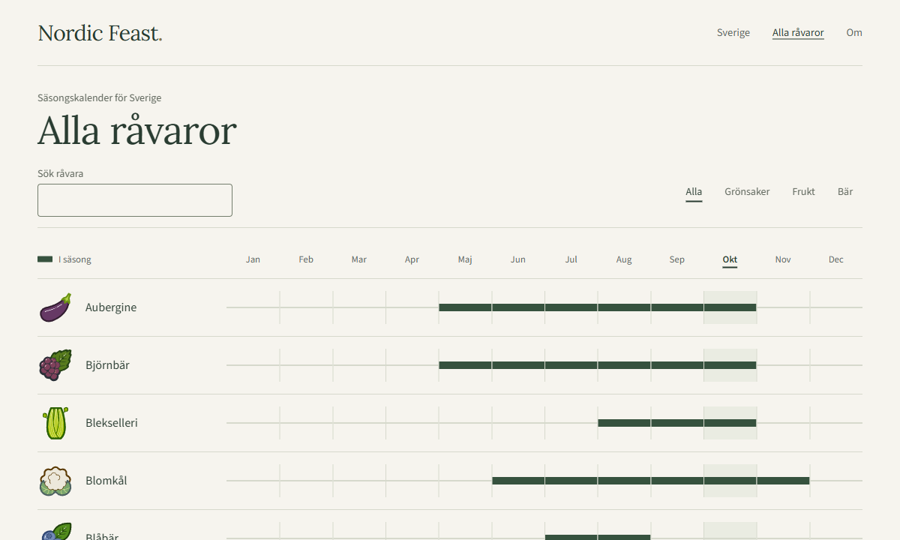

# Nordic Feast

A Swedish-language calendar of Swedish vegetables, fruit and berries in season, month by month. Every ingredient cites the source its season comes from.

**Site:** https://nordicfeast.stranne.se



- **Month pages** show which of the 59 ingredients are in season, with search and category filters.
- **The catalogue** shows every ingredient's season on one shared month scale.
- **Ingredient pages** show the season as a labelled calendar with a link to its source.

The site is static, built with [Zola](https://www.getzola.org/). Every page works without JavaScript; small optional scripts open the current month and remember filters. Accessibility is a design requirement, not an add-on.

## How the season data works

Each ingredient in `content/ravaror/` uses one primary source, chosen per ingredient: ICA, Från Sverige, SydGrönt, Säsongens Bästa or Hebe. A month the source lists is **in season**; every other month is **out of season**. There are no estimated peaks or harvest windows.

Sources do not consistently separate fresh harvest, storage and greenhouse production, so periods can include stored or protected-grown produce. Ingredient notes say so where it matters. The [source review](docs/source-decision.md) records how each source was evaluated and where sources disagree.

## Run locally

Install [Zola](https://www.getzola.org/documentation/getting-started/installation/), for example with `winget install getzola.zola` on Windows or `brew install zola` on macOS. Use the version pinned in the [CI setup](.github/actions/setup-zola/action.yml), because template behaviour can change between Zola releases. Then run:

```sh
zola serve
```

The site is served at http://127.0.0.1:1111. Use `--port 1112` if the default port is occupied.

## Checks

```sh
zola build                          # content structure and references
zola check --skip-external-links    # internal links in Markdown content
```

The build stops with a message when an ingredient, source, image credit or month page is invalid, or when the weights put the catalogue out of alphabetical order. `zola serve` runs the same checks. They live in `templates/partials/check-ingredient.html` and `check-catalogue.html`. `zola check` does not render templates, so it does not run them.

The browser check covers keyboard navigation, filters, axe rules, enlarged text, forced colours, reduced motion and JavaScript-disabled navigation. It needs Node.js, Chrome and a running preview:

```sh
npm ci
npm run check:a11y
```

Set `PREVIEW_URL` for another preview address or `BROWSER_CHANNEL=msedge` to use Edge. The npm packages are development checks only; the site has no npm dependencies.

## Deployment

The [Site workflow](.github/workflows/site.yml) runs the checks on every pull request. On `main`, it also deploys the site to GitHub Pages.

To set up hosting:

1. In the repository settings, set **Pages → Source** to **GitHub Actions**.
2. Verify `stranne.se` under **GitHub account settings → Pages** to protect the domain from takeover.
3. Add a DNS `CNAME` record from `nordicfeast.stranne.se` to `stranne.github.io`.
4. Set **Pages → Custom domain** to `nordicfeast.stranne.se` and enable **Enforce HTTPS** once the certificate is issued.

The workflow takes the site address from Pages, so builds use the github.io address until the custom domain is active. `base_url` in `zola.toml` only affects local `zola build`.

## Project layout

| Path | Contents |
| --- | --- |
| `content/ravaror/` | One ingredient per file, with its season in TOML front matter |
| `content/sverige/` | One page per month |
| `data/` | Sources, image provenance and month names |
| `templates/`, `static/` | Layout, content checks, styles, scripts, fonts and icons |
| `scripts/` | Browser checks and share image |
| `docs/` | [Interface behaviour](docs/interface.md), [accessibility review](docs/accessibility.md) and source reviews |

## Contributing

Season corrections with a source are especially welcome. See [CONTRIBUTING.md](CONTRIBUTING.md).

## Licence

The code and content are available under the [MIT licence](LICENSE). The illustrations are [Open Crop Icons](https://github.com/openfarmcc/open-crop-icons) (CC0), and the fonts and interface icons keep their own licences. See [third-party notices](THIRD_PARTY_NOTICES.md). The illustrations show each ingredient in general, not a particular cultivar.
